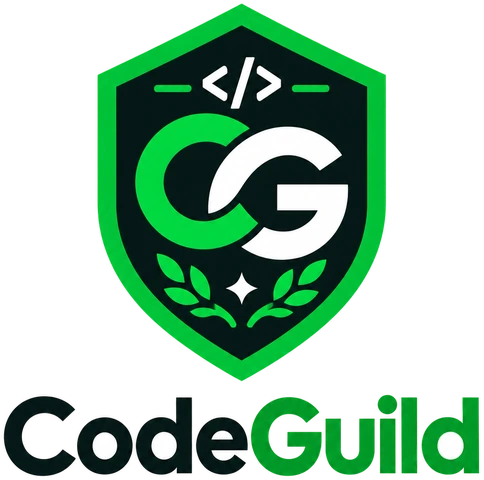

<p align="center">
  
</p>

# CodeGuild

**Fraternidade Acadêmica de Desenvolvedores**

## Visão geral

A CodeGuild é uma plataforma acadêmica para estudantes e desenvolvedores em formação. A ideia é aproximar pessoas por tecnologias e interesses para que elas possam:

- criar um **perfil técnico** (nível, bio, interesses, tecnologias dominadas e estudadas, usuário do GitHub);
- encontrar **projetos** de colegas;
- formar **equipes**;
- futuramente, **candidatar-se a vagas** desses projetos;
- exibir no perfil as **informações públicas do GitHub** (perfil, repositórios e linguagens).

O projeto é desenvolvido na disciplina *Desenvolvimento de Software para Web*. A seção [Estado atual](#estado-atual) diz o que já funciona e o que ainda está planejado.

## Tecnologias

| Camada | Tecnologias |
|---|---|
| Backend | Python 3.10+, FastAPI, SQLModel (SQLAlchemy + Pydantic), PostgreSQL (driver `psycopg2`), JWT (`python-jose`) com senha em hash (`bcrypt`), `python-dotenv` |
| Frontend | HTML5, CSS3 e JavaScript puro (sem framework e sem etapa de build) |
| Integração externa | GitHub REST API (perfil público, repositórios e linguagens), via `httpx` no backend |

## Estado atual

**Implementado**

- Cadastro, login e logout.
- Sessão com JWT (expira em 30 minutos; ao expirar, o frontend encerra a sessão).
- Proteção das páginas privadas (painel, minhas candidaturas, perfil) e da área autenticada da API.
- Perfil técnico: criar, consultar e editar (`/me/profile`).
- Catálogo de tecnologias (`/technologies`).
- Integração com a GitHub REST API na tela de perfil: perfil público, repositórios recentes e linguagens. Os dados ficam salvos no banco com a data da última consulta e são atualizados sob demanda (no máximo a cada 10 minutos); se o GitHub estiver fora do ar, os dados salvos continuam sendo exibidos e o resto do sistema funciona normalmente.
- Navegação pública e autenticada: o header muda conforme a sessão; visitantes navegam pelas páginas públicas sem serem levados ao login.
- Projetos: criar, editar, listar e encerrar (`/projects`, `/me/projects`). O mural (explorar) e os detalhes são públicos; só o responsável edita ou encerra o projeto, e encerrar também encerra as vagas abertas dele. O painel mostra "Meus projetos" e os projetos abertos mais recentes.
- Vagas: o responsável anuncia, edita e encerra vagas por especialidade, stack, nível e quantidade nos detalhes do projeto (`/projects/{id}/vacancies`, `/vacancies/{id}`). Cada vaga mostra quantas posições restam (quantidade menos candidaturas aprovadas); vaga encerrada, sem posição livre ou de projeto encerrado não aceita candidaturas. O mural mostra, por projeto, as vagas abertas e a stack pedida.
- Landing page com as seções Como funciona, Projetos e Benefícios, contagem regressiva e pré-cadastro.
- Trava de lançamento: até `LAUNCH_AT` o cadastro fica fechado e só a equipe (`EARLY_ACCESS_USER_IDS`) entra; visitantes usam o pré-cadastro. Detalhes em [`backend/README.md`](backend/README.md#trava-de-lançamento).
- Candidaturas: candidatar-se a uma vaga com mensagem, acompanhar e cancelar em "Minhas candidaturas" (filtros por status) e, para o responsável, ver os candidatos de cada vaga com o resumo do perfil e aprovar ou rejeitar. Uma candidatura ativa por pessoa em cada vaga; aprovar ocupa uma posição da vaga e coloca a pessoa na "Equipe" do projeto.
- API FastAPI + PostgreSQL, com seed de dados para desenvolvimento.

**Planejado**

- Match por tecnologias.
- Busca e filtros funcionais, recuperação de senha e layout responsivo para celular.

## Estrutura do projeto

```
code-guild/
├── backend/
│   ├── api/                # rotas (auth, users, profile, technologies, github, projects, leads, items)
│   ├── auth/               # hash de senha, JWT e dependência de usuário autenticado
│   ├── integration/        # conexão com o banco (database.py)
│   ├── models/             # tabelas e schemas SQLModel
│   ├── services/           # regras de negócio
│   ├── main.py             # aplicação FastAPI (CORS e registro das rotas)
│   ├── requirements.txt
│   ├── seed.py             # dados de desenvolvimento
│   ├── .env.example        # modelo de configuração (versionado)
│   └── .env                # configuração LOCAL (não versionado)
├── paginas/                # uma pasta por tela: index.html + style.css
├── scripts/                # JavaScript compartilhado e de cada tela
├── estilos/global.css      # estilos compartilhados
├── marca/
│   ├── originais/          # logos originais em alta resolução (fonte dos arquivos de web/)
│   └── web/                # logos e favicons otimizados para o site (WebP/PNG/ICO)
├── docs/
│   ├── planejamento/       # proposta e escopo, registro da escolha do nome (PDF)
│   ├── prototipo/          # protótipo das telas (PDF)
│   ├── auditoria/          # relatórios de auditoria do projeto
│   └── print-sistema/      # prints do sistema para a apresentação (só local, não versionado)
└── README.md
```

## Configuração do ambiente

### 1. PostgreSQL

Com o PostgreSQL instalado e rodando, crie o banco `codeguild_db`:

```bash
psql -U postgres -c "CREATE DATABASE codeguild_db;"
```

A URL de conexão segue o formato:

```
postgresql://postgres:<senha>@localhost:5432/codeguild_db
```

As tabelas são criadas automaticamente quando o backend inicia (não há migrations).

### 2. Backend

```bash
cd backend
python -m venv venv
source venv/bin/activate        # Windows: venv\Scripts\activate
pip install -r requirements.txt
cp .env.example .env            # Windows: copy .env.example .env
```

Em algumas distribuições Linux o comando é `python3` em vez de `python`.

### 3. Arquivo `.env`

Edite `backend/.env` (criado a partir de `backend/.env.example`):

| Variável | Uso |
|---|---|
| `DATABASE_URL` | conexão com o PostgreSQL (obrigatória) |
| `SECRET_KEY` | assinatura dos tokens JWT; use um valor longo e aleatório, por exemplo `python -c "import secrets; print(secrets.token_hex(32))"` |

O `.env` é local de cada integrante e está no `.gitignore`: **nunca faça commit dele**.

As variáveis `GITHUB_API_URL` e `GITHUB_TOKEN` são **opcionais** (comentadas no `.env.example`); sem elas a integração com o GitHub funciona normalmente. O `GITHUB_TOKEN` só aumenta o limite de consultas da API do GitHub (60 por hora sem token, 5.000 com) e **nunca deve ser commitado**.

`LAUNCH_AT` e `EARLY_ACCESS_USER_IDS` também são opcionais: sem `LAUNCH_AT` não há trava de lançamento e a contagem regressiva da landing não aparece. Para testar a trava localmente, defina as duas (ex.: `LAUNCH_AT=2026-12-01T19:00:00-03:00` e `EARLY_ACCESS_USER_IDS=1`).

### 4. Executar o backend

Dentro de `backend/`, com o ambiente virtual ativado:

```bash
fastapi dev
# ou
uvicorn main:app --reload
```

- API: http://127.0.0.1:8000
- Swagger (documentação interativa): http://127.0.0.1:8000/docs

### 5. Dados de desenvolvimento (seed)

Com o `.env` configurado, dentro de `backend/`:

```bash
python seed.py
```

Popula o banco se ele estiver vazio (rodar de novo não duplica): 33 tecnologias, 12 usuários com perfil técnico, 6 projetos, 12 vagas e 14 candidaturas, com os mesmos nomes do protótipo. Não altera `lead` nem `item`.

Credencial de exemplo: usuário `pedro`, senha `123456`. **É uma credencial de desenvolvimento criada pelo seed; não utilizar em produção.**

> ⚠️ `python seed.py --reset` é **destrutivo**: apaga todos os usuários, tecnologias, perfis, projetos, vagas e candidaturas antes de popular de novo. Use só se quiser realmente recomeçar o banco local.

### 6. Frontend

Não há build. Na raiz do projeto:

```bash
python -m http.server 5500 --bind 127.0.0.1
```

Abra http://127.0.0.1:5500/paginas/inicio/index.html.

- Use sempre `127.0.0.1` (e não `localhost`): o token de login fica no `localStorage`, que é separado por endereço; trocar entre os dois parece "deslogar".
- O frontend chama a API em `http://127.0.0.1:8000` (constante `API_URL` em `scripts/api.js`); o backend precisa estar rodando.
- O `http.server` não controla cache. Depois de alterar CSS ou JS, recarregue com **Ctrl+Shift+R**.

## Páginas

| Página | Acesso |
|---|---|
| `paginas/inicio` | pública (landing; mostra "Ir para o painel" quando há sessão) |
| `paginas/login`, `paginas/cadastro` | visitante (com sessão, redirecionam ao painel; o login aceita `?next=<caminho>` e, depois de entrar, volta para essa página, só se for caminho interno como `../detalhes-projeto/index.html?id=3`) |
| `paginas/explorar`, `paginas/detalhes-projeto` | públicas (header muda conforme a sessão; o responsável vê "Editar" e "Encerrar" nos detalhes) |
| `paginas/painel`, `paginas/minhas-candidaturas`, `paginas/perfil`, `paginas/projeto-form` | privadas (sem sessão, redirecionam ao login com `?next=` da página aberta); `projeto-form` cria projeto ou, com `?id=N`, edita |

## Endpoints da API

| Método e rota | Autenticação | Descrição |
|---|---|---|
| `POST /register` | — | cria conta (usuário, e-mail, senha); 422 se a senha tiver menos de 8 caracteres ou mais de 72 bytes, o usuário não seguir `[a-z0-9._-]{3,30}` ou o e-mail for inválido; 400 se usuário ou e-mail já existirem (sem diferenciar maiúsculas); antes do lançamento responde 403 |
| `POST /login` | — | devolve o token JWT; antes do lançamento só para a equipe (403 para os demais) |
| `GET /launch` | — | data do lançamento e se a plataforma já está aberta (`{launch_at, open}`) |
| `GET /me` | Bearer | usuário autenticado, com resumo do perfil (ou `null`) |
| `GET /me/profile` · `POST /me/profile` · `PUT /me/profile` | Bearer | consulta, cria e edita o perfil técnico (422 se nome com menos de 2 caracteres visíveis, bio acima de 1000, interesses acima de 500 ou usuário do GitHub inválido) |
| `GET /technologies` | — | catálogo de tecnologias |
| `GET /me/github` | Bearer | dados do GitHub salvos no perfil (não consulta o GitHub) |
| `POST /me/github/refresh` | Bearer | consulta o GitHub agora e salva (no máximo a cada 10 minutos) |
| `GET /projects` | — | mural de projetos, mais recentes primeiro; `?status=OPEN\|CLOSED`, paginado com `skip` e `limit` (padrão 20, máx. 100); cada projeto traz `open_vacancies` e a stack (`technologies`) das vagas abertas |
| `GET /projects/{id}` | — | detalhes de um projeto (com o responsável e o mesmo resumo de vagas) |
| `GET /me/projects` | Bearer | projetos de que o usuário é responsável (abertos e encerrados) |
| `POST /projects` | Bearer | cria projeto (título, descrição, link do GitHub opcional); o usuário vira o responsável |
| `PUT /projects/{id}` | Bearer | edita o projeto; só o responsável (403) e só se estiver aberto (409) |
| `POST /projects/{id}/close` | Bearer | encerra o projeto e as vagas abertas dele; só o responsável; não há reabertura |
| `GET /projects/{id}/vacancies` | — | vagas do projeto (abertas primeiro), com `filled`, `available` e `accepts_applications` |
| `POST /projects/{id}/vacancies` | Bearer | anuncia vaga (especialidade, quantidade 1–50, nível opcional, descrição, `technology_ids`); só o responsável, projeto aberto |
| `PUT /vacancies/{id}` | Bearer | edita a vaga (inclusive a stack); só o responsável; vaga e projeto abertos; quantidade não fica abaixo das aprovadas (409) |
| `POST /vacancies/{id}/close` | Bearer | encerra a vaga (deixa de aceitar candidaturas); só o responsável; não há reabertura |
| `POST /vacancies/{id}/applications` | Bearer | candidata-se à vaga (mensagem opcional); exige perfil técnico; uma candidatura ativa por vaga |
| `GET /me/applications` | Bearer | candidaturas do usuário, mais recentes primeiro |
| `GET /projects/{id}/applications` | Bearer | candidaturas das vagas do projeto com o perfil do candidato; só o responsável |
| `GET /projects/{id}/members` | — | equipe do projeto (candidaturas aprovadas, com a vaga de cada pessoa) |
| `POST /applications/{id}/approve` · `POST /applications/{id}/reject` | Bearer | aprova ou rejeita uma candidatura pendente; só o responsável; aprovar exige posição livre (409) |
| `POST /applications/{id}/cancel` | Bearer | cancela a própria candidatura pendente |
| `POST /leads` | — | pré-cadastro de interessados (formulário da landing); não há rota de listagem |
| `/users/{id}` (GET/PUT/DELETE), `POST /users` | Bearer, exceto `POST` | cada usuário só vê e altera a própria conta; não há listagem |
| `/items` (CRUD) | Bearer | exemplo de aula, sem uso no produto |

Detalhes dos modelos e das camadas do backend: [`backend/README.md`](backend/README.md).

## Documentação

A pasta `docs/` é organizada por assunto: `planejamento/` (documento de proposta e escopo, com MVP, arquitetura, regras e roadmap, e o registro da escolha do nome), `prototipo/` (protótipo das telas), `auditoria/` (relatórios de auditoria) e `print-sistema/` (prints do sistema para a apresentação; o conteúdo fica só na máquina de quem os gerou, ignorado pelo `.gitignore`).

---

**Equipe (Founders):** Matheus Vasco, Pedro Simon, Erick Alves, Guilherme Leal e Guilherme Silva.
*Disciplina: Desenvolvimento de Software para Web*
